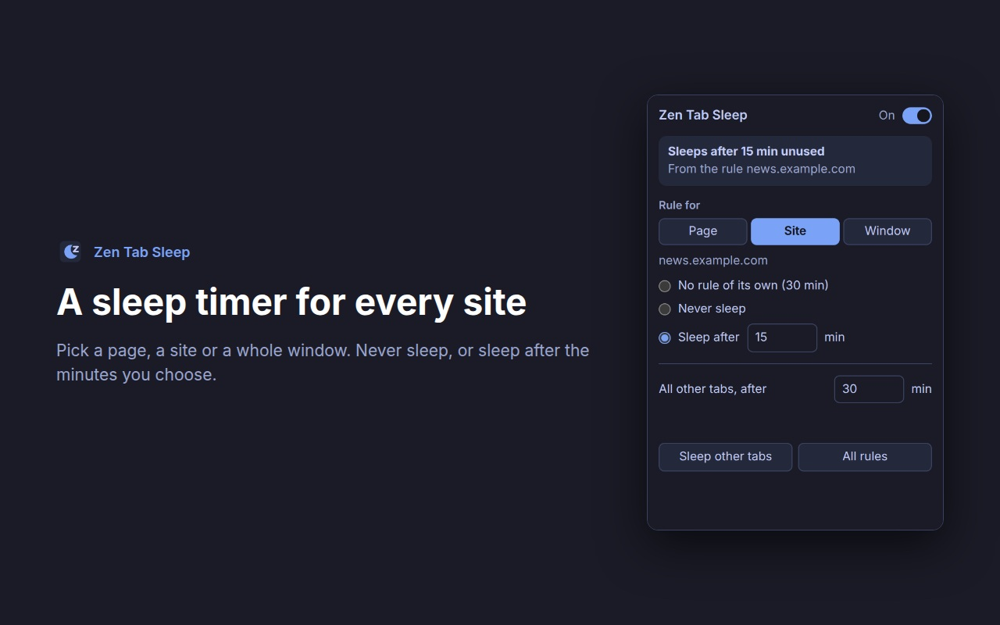

# Zen Tab Sleep

Auto-suspend unused tabs and free RAM in Chrome, Brave, Edge and other Chromium browsers, with a
separate timer or exclusion for each page, site or window.

*[Leer en español](#español)*



## Features

- **A timer per page, site or window**, or "never sleep" for any of them.
- **Wildcards:** `*.atlassian.net/jira/*`, `github.com/*/issues`.
- **The most specific rule wins:** page or site, then window, then the general time.
- **Window rules survive restarts:** the rule recognizes its window by its tabs.
- **Never touched:** the visible tab of each window and tabs playing sound. Pinned tabs too, if you choose.
- **Quick controls:** the icon shows how many tabs are sleeping, and right-clicking it adds shortcuts.
- **Backup:** export and import your rules as JSON.
- **YouTube without AV1:** tells YouTube that AV1 is not supported, so it sends VP9, which more GPUs decode in hardware. It runs on every computer and cannot be turned off.
- **Private:** site access only on YouTube, for that codec check. No analytics, no network requests. Settings stay in your browser. See [PRIVACY.md](PRIVACY.md).
- English and Spanish.

WhatsApp Web, Microsoft Teams and Outlook start as "never sleep" so you keep getting their
notifications. You can change that.

## Install from source

1. `git clone https://github.com/Freddy-devs/zen-tab-sleep`
2. Open `chrome://extensions` (or `brave://extensions`) and turn on **Developer mode**.
3. Click **Load unpacked** and choose the `extension` folder.

Requires Chromium 116 or newer.

## How it works

It uses the browser's native [`tabs.discard`](https://developer.chrome.com/docs/extensions/reference/api/tabs#method-discard).
A sleeping tab stays in the tab strip and reloads when you return to it. It checks every 30 seconds,
so a tab can sleep up to 30 seconds after its time is up. A page reloads when you return to it, so
anything it did not save itself may be lost: add a "never sleep" rule for pages like that.

## Develop

```sh
node --test tests/*.test.mjs   # tests
./scripts/package.sh           # builds dist/zen-tab-sleep-<version>.zip
```

Pushing a `v*` tag publishes that zip as a GitHub release. Store texts and images are in [`store/`](store/).

## License

[MIT](LICENSE). You can clone, change and publish your own version.

---

## Español

Duerme las pestañas sin usar y libera RAM en Chrome, Brave, Edge y otros navegadores Chromium, con un
tiempo o una exclusión para cada página, sitio o ventana.

- **Un tiempo por página, sitio o ventana**, o «nunca dormir» en cualquiera de ellos.
- **Comodines:** `*.atlassian.net/jira/*`, `github.com/*/issues`.
- **Gana la regla más específica:** página o sitio, luego ventana y luego el tiempo general.
- **Las reglas de ventana sobreviven al reinicio:** la regla reconoce su ventana por sus pestañas.
- **Nunca se tocan** la pestaña visible de cada ventana ni las que suenan; las fijadas, si quieres.
- **Privada:** sin acceso a los sitios, sin analítica y sin peticiones de red. Ver [PRIVACY.md](PRIVACY.md).

Para instalarla desde el código: clona el repo, abre `chrome://extensions` o `brave://extensions`,
activa el **modo desarrollador**, pulsa **Cargar descomprimida** y elige la carpeta `extension`.
